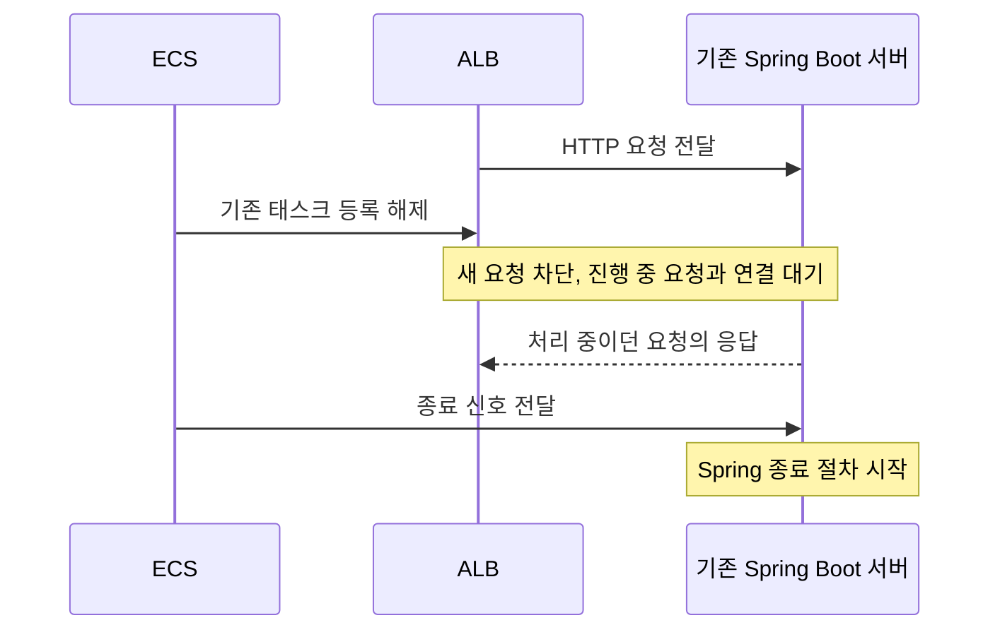
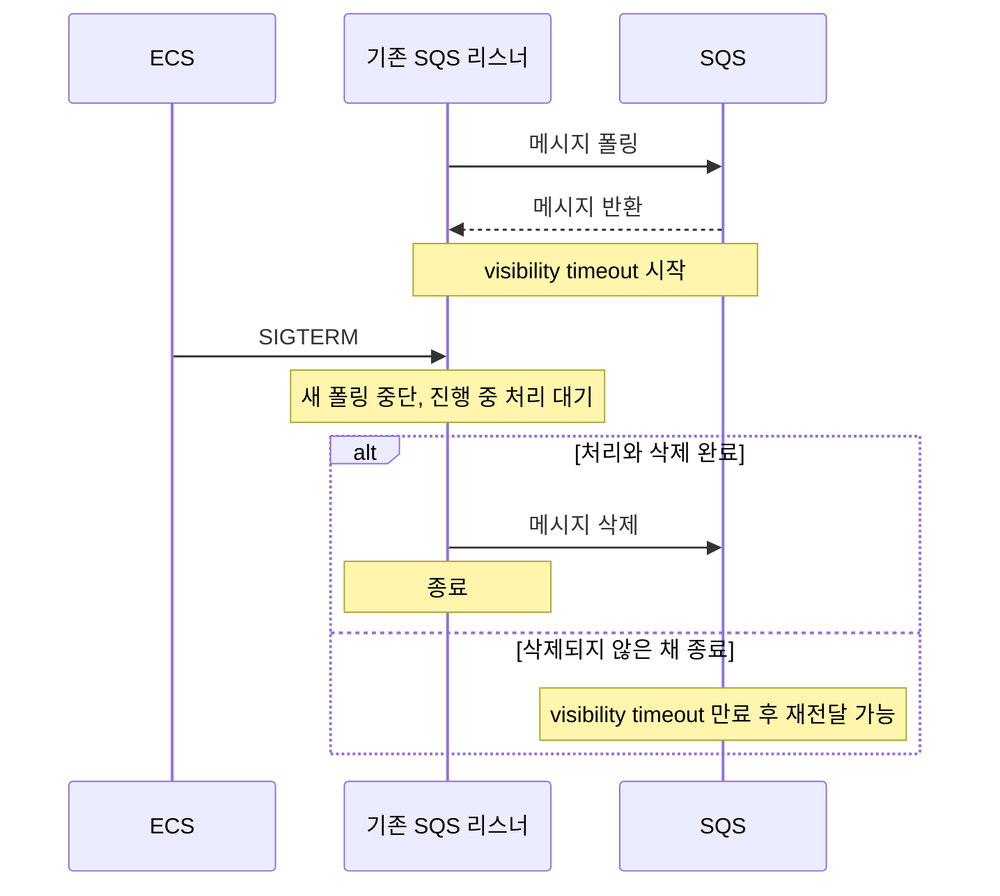

새 버전을 배포하면 기존 서버는 종료된다. 그런데 종료할 서버가 아직 작업 중이라면 어떻게 될까?

프로세스를 바로 종료하면 처리 중이던 작업도 끊긴다. 그래서 새 작업은 받지 않으면서, 이미 시작한 작업을 마칠 시간을 주는 과정이 필요하다. 이를 graceful shutdown이라고 한다.

서버에는 클라이언트의 요청을 처리하는 코드뿐 아니라, 큐에서 메시지를 가져오거나 정해진 시간에 실행되는 백그라운드 작업도 있다.

ECS에서 Spring Boot 서버를 운영할 때는 요청 처리와 백그라운드 작업의 종료 과정을 함께 살펴봐야 한다. 작업의 종류에 따라 새 작업을 막는 방식과 진행 중인 작업을 마무리하는 과정이 다르기 때문이다.

여기서는 ALB를 통한 HTTP 요청과, 백그라운드 작업의 예로 SQS 메시지 소비를 살펴본다.

## 1. 요청 처리: ALB에서 새 요청을 먼저 막는다

ALB는 클라이언트의 HTTP 요청을 서버에 분배한다. ECS에서 컨테이너를 실행하는 단위를 태스크라고 하는데, 기존 태스크를 교체할 때는 먼저 ALB의 요청 분배 대상에서 제외한다.

ALB가 연결된 ECS 서비스의 롤링 배포에서는 다음 순서로 진행된다.



기존 서버를 곧바로 끄는 대신, 요청을 마칠 기회를 먼저 주는 것이다.

이 대기 시간을 정하는 설정이 ALB 타깃 그룹의 `deregistration_delay.timeout_seconds`다. 기본값은 300초다. 진행 중인 요청과 활성 연결이 없다면 실제 등록 해제는 더 일찍 끝날 수 있다.

다만 정해진 시간을 넘긴 요청까지 정상 응답을 보장하지는 않는다. 오래 걸리는 요청이 있다면 이 값을 너무 짧게 잡아서는 안 된다.

## 2. 종료 신호를 받으면 Spring이 정리를 시작한다

Linux 컨테이너의 기본 종료 신호는 `SIGTERM`이다. JVM이 이 신호를 받아 정상 종료 절차를 시작하면, Spring Boot의 종료 훅이 애플리케이션 컨텍스트를 닫는다.

이 과정에서 웹 서버와 리스너 같은 컴포넌트가 종료된다. 웹 서버의 graceful shutdown이 활성화되어 있다면 기존 HTTP 요청이 끝나기를 기다린다.

백그라운드 작업은 사용하는 스케줄러, 실행기, 리스너의 종료 방식에 따라 달라진다. Spring이 종료된다는 이유만으로 모든 백그라운드 작업의 완료를 기다려 주는 것은 아니다.

ECS도 계속 기다리지는 않는다. 종료 신호를 보낸 뒤 `stopTimeout`이 지나도록 프로세스가 종료되지 않으면 `SIGKILL`로 강제 종료한다. 이때는 Spring도 정리 작업을 계속할 수 없다.

**ALB가 연결을 비우는 시간과, 종료 신호 이후 ECS가 기다리는 시간은 별개다.**

## 3. 백그라운드 작업: SQS 메시지를 처리하고 있었다면

백그라운드 작업은 ALB에서 새 요청을 막는 것만으로 멈추지 않는다. 예를 들어 SQS 메시지를 소비하는 서버는 리스너가 직접 큐를 조회해 메시지를 가져온다.

따라서 기존 태스크를 ALB에서 제외해도 SQS 소비는 계속될 수 있다.

Spring Cloud AWS의 SQS 리스너는 종료 과정에서 새 폴링을 멈추고, 진행 중인 메시지 처리와 남은 삭제 작업을 정해진 시간 동안 기다린다.



SQS에서는 메시지 처리와 삭제가 별도 작업이다. 주문 처리는 끝났지만 메시지를 삭제하기 전에 서버가 종료되면, 다른 서버가 같은 메시지를 받아 주문 처리를 다시 실행할 수 있다.

`visibility timeout`은 메시지를 받은 소비자가 작업하는 동안 다른 소비자에게 메시지를 숨기는 시간이다. 종료 신호를 받은 때가 아니라 **메시지를 받은 때부터** 계산한다.

표준 큐는 삭제가 성공해도 드물게 중복 전달될 수 있다. 따라서 같은 메시지를 다시 처리해도 주문이나 발송이 중복되지 않도록 멱등성을 갖춰야 한다.

다른 백그라운드 작업도 새 작업을 어떻게 막을지, 진행 중인 작업을 얼마나 기다릴지, 중간에 종료된 작업을 어떻게 복구할지 확인해야 한다.

## 4. 어떤 설정을 조절해야 할까?

종료 관련 설정은 각각 기다리는 대상이 다르다. 아래 SQS 설정은 백그라운드 작업 전체에 적용되는 설정이 아니라, Spring Cloud AWS의 SQS 리스너에 적용되는 설정이다. SQS 리스너 기본값은 4.0.2 기준이다.

| 설정 위치          | 설정                                          | 기본값             | 역할                                                                 | 관련 문서                                                                                                                                                                          |
| ------------------ | --------------------------------------------- | ------------------ | -------------------------------------------------------------------- | ---------------------------------------------------------------------------------------------------------------------------------------------------------------------------------- |
| ALB 타깃 그룹      | `deregistration_delay.timeout_seconds`        | 300초              | 등록 해제 중 진행 중인 HTTP 요청과 연결 대기                         | [AWS 공식 문서](https://docs.aws.amazon.com/ko_kr/elasticloadbalancing/latest/application/edit-target-group-attributes.html#deregistration-delay)                                  |
| Spring Boot        | `server.shutdown`                             | 3.4부터 `graceful` | 웹 서버의 종료 방식 선택. 3.3 이하에서는 `graceful`을 명시해야 한다. | [Spring Boot 3.4 릴리스 노트](https://github.com/spring-projects/spring-boot/wiki/Spring-Boot-3.4-Release-Notes#graceful-shutdown)                                                 |
| Spring Boot        | `spring.lifecycle.timeout-per-shutdown-phase` | 30초               | 같은 종료 단계에 속한 컴포넌트들의 비동기 종료 대기                  | [Spring Boot 공식 문서](https://docs.spring.io/spring-boot/3.5/appendix/application-properties/index.html#application-properties.core.spring.lifecycle.timeout-per-shutdown-phase) |
| SQS 리스너         | `listenerShutdownTimeout`                     | 20초               | 진행 중인 폴링과 메시지 처리 대기                                    | [Spring Cloud AWS 공식 문서](https://docs.awspring.io/spring-cloud-aws/docs/4.0.2/reference/html/index.html)                                                                       |
| SQS 리스너         | `acknowledgementShutdownTimeout`              | 20초               | 처리 대기가 끝나거나 시간 초과된 뒤, 남은 배치 삭제 작업 대기        | [Spring Cloud AWS 공식 문서](https://docs.awspring.io/spring-cloud-aws/docs/4.0.2/reference/html/index.html)                                                                       |
| ECS 컨테이너 정의  | `stopTimeout`                                 | Fargate 기준 30초  | 종료 신호 이후 강제 종료까지의 제한 시간                             | [AWS ECS 공식 문서](https://docs.aws.amazon.com/AmazonECS/latest/APIReference/API_ContainerDefinition.html#ECS-Type-ContainerDefinition-stopTimeout)                               |
| SQS 큐 또는 메시지 | `VisibilityTimeout`                           | 큐 기본값 30초     | 수신한 메시지가 다른 소비자에게 다시 보이기까지의 시간               | [AWS SQS 공식 문서](https://docs.aws.amazon.com/AWSSimpleQueueService/latest/APIReference/API_CreateQueue.html)                                                                    |

Spring 설정은 다음처럼 작성할 수 있다.

```yaml
server:
    shutdown: graceful

spring:
    lifecycle:
        timeout-per-shutdown-phase: 30s
```

이 `30s`는 서버 전체가 30초 안에 종료된다는 뜻이 아니다. Spring은 컴포넌트를 여러 단계로 나눠 종료하므로, 각 단계의 대기와 다른 정리 작업이 더해질 수 있다. 동기 종료 작업까지 이 값으로 강제 중단하는 것도 아니다.

SQS의 두 종료 대기 값은 리스너 컨테이너 팩토리의 `.configure(...)`에서 지정한다. 처리 대기 후 배치 삭제 대기가 이어지므로 기본값만으로도 명목상 20초 + 20초를 기다릴 수 있다.

반면 Fargate의 `stopTimeout` 기본값은 30초다. **각 설정을 기본값으로 뒀다고 해서 Spring과 백그라운드 작업의 정리가 끝날 때까지 ECS가 기다려 주는 것은 아니다.** Fargate에서는 `stopTimeout`을 2~120초로 설정할 수 있다. EC2에서는 태스크 정의에 값이 없으면 에이전트 설정을 따른다.

실제로는 요청이나 백그라운드 작업을 처리하는 중에 배포해 보고, 종료 신호부터 JVM 종료까지 걸린 시간을 측정해야 한다.

SQS를 사용한다면 처리 완료 로그뿐 아니라 실제 삭제 완료도 확인해야 한다. 배치 삭제를 사용하면 acknowledgement 호출이나 반환된 Future의 완료만으로 삭제 성공을 판단할 수 없다. 다른 백그라운드 작업도 완료 여부를 확인할 수 있는 기록과 재시도 방법이 필요하다.
